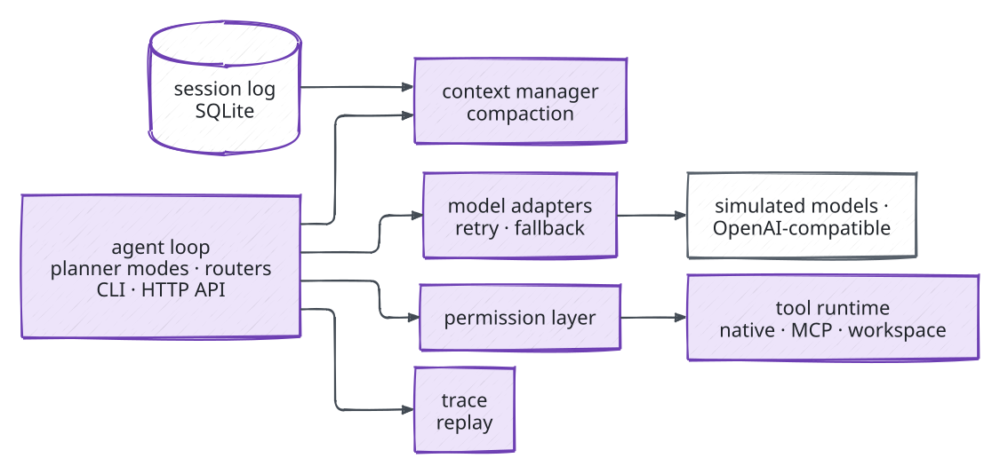
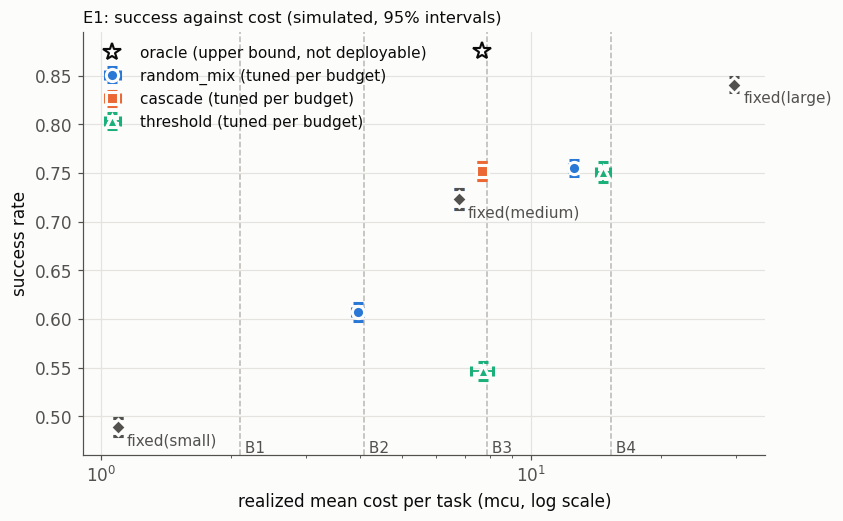
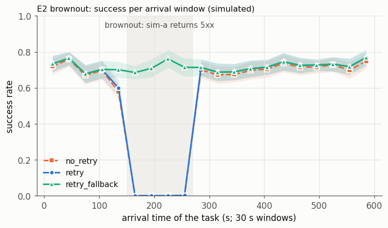

<p align="center"></p>

<p align="center">
<a href="https://github.com/AKASB1/agent-runtime/actions/workflows/ci.yml"></a>
<a href="LICENSE"></a>


</p>

# agent-runtime

A small, deterministic, replayable agent runtime: the layer between a model and its tools.

<p align="center"><a href="#quick-demo">Quick demo</a> · <a href="#cli">CLI</a> · <a href="#how-does-agent-runtime-work">How it works</a> · <a href="#results">Results</a> · <a href="#security">Security</a> · <a href="#documentation">Documentation</a> · <a href="#limitations">Limitations</a></p>

> **Simulated models.** Every model in the evaluations is simulated, with assumed accuracies, prices, and latencies ([assumptions](#assumptions-of-the-simulation)); no hosted model was called.

An agent harness decides what a model sees, which tools it may call and under which permissions, how failures are retried, and what each run costs. This runtime makes each of these decisions explicit, replayable, and measurable. Model requests and responses are typed, with a closed error taxonomy. Native tools, MCP servers over stdio, and workspace tools share one typed registry, and a permission layer sits in front of every tool call. Every model input is derived from a logged session, subagents run under a budget share, and one trace per run replays without calling a provider or a tool. An evaluation runner with paired statistics compares the decision rules (routing under a cost budget, retry and fallback, planning, scheduling, context policies) against simple baselines.

<p align="center"></p>

<a id="highlights"></a>
Costs are in mcu, thousandths of an abstract cost unit. On each seed, a configuration wins, ties, or loses (W/T/L) by a dominance rule ([docs/evaluation.md](docs/evaluation.md)). It wins when it is better on the primary metric beyond a tie band and not worse on any guard metric. B1 to B4 are four cost budgets per task, spaced geometrically between the costs of `fixed(small)` and `fixed(large)`. The routers (`random_mix`, `cascade`), the planner modes (`react`, `plan_replan`), and the context policies are explained under [How it works](#how-does-agent-runtime-work).

- **A cascade buys success at a budget, but only as a trade-off.** At the budget level B3, the cascade medium → large reaches 0.752 success against 0.723 for the best random mix, at 14% more cost. That is a tie on 29 of 30 seeds ([E1](docs/results.md#e1-routing-under-a-cost-budget)).
- **Fallback is what survives a brownout.** When one provider fails every call that starts between 150 s and 270 s, retries alone keep success at 0.575. Fallback to a second provider keeps it at 0.723 (+0.148 ± 0.009), at 2.68 wasted calls per task ([E2](docs/results.md#e2-reliability-under-provider-faults)).
- **Planning cuts makespan and cost; replanning recovers almost all of the success.** With k = 2 and no tool failures, `plan_replan` cuts the median makespan by 3.74 s and the cost from 10.92 to 5.06 mcu against `react`. Its success is 0.540 against 0.550 ([E3](docs/results.md#e3-planning-and-scheduling)).
- **The verifier catches the scripted wrong candidates, with one blind spot.** On six LP, ILP, and MILP problems with a scripted model, every accepted objective equals the reference. On `facility` the verifier accepts a candidate that drops a non-binding constraint ([E4](docs/results.md#e4-the-optimization-agent)).
- **Compaction removes context overflows, at a price with the cache on.** With 3000-token tool results on `medium`, every context policy removes the overflow failures and gains 0.031–0.034 success; `window` and `summarize` cost 71–72% more with the prompt cache on ([E5](docs/results.md#e5-context-policies)).
- **Delegation halves the context but loses success.** Against `react_medium` (one `react` agent on `medium`), `delegate` halves the parent's peak input (4312 against 8774 tokens) and costs 47% less. It succeeds on 0.282 of the tasks against 0.548, a loss on every seed ([E6](docs/results.md#e6-delegation)).

## Quick demo

You need Python 3.12. Create the environment once; it installs the package with all extras into `.venv` from PyPI. Then run the tests. In Windows PowerShell:

```powershell
powershell -ExecutionPolicy Bypass -File scripts\setup_env.ps1
.venv\Scripts\python.exe -m pytest -q
```

On Linux or macOS (bash):

```bash
bash scripts/setup_env.sh
source .venv/bin/activate
python -m pytest -q
```

In Git Bash on Windows, activate with `source .venv/Scripts/activate`. Run the shell scripts through `bash`, or run `chmod +x scripts/*.sh` once.

Then run the demo and the scripted agent with the environment's Python:

```bash
python scripts/demo.py
python examples/agent/run_agent.py
```

- `scripts/demo.py` starts a local stand-in provider and the service on 127.0.0.1 (ports 18510 and 18500) and stops both by PID at the end. In between it runs a chat session through the OpenAI-compatible adapter, a `react` run on the simulated models, an `optimize` run, and an `agent` run in a session workspace. The agent writes, reads, and edits a file, runs a harmless command, is denied a write outside the workspace, and delegates a lookup to a child agent. The demo then forks the session, reads a trace, replays a run, and prints `/v1/usage`.
- `examples/agent/run_agent.py` runs the same scripted agent without the service, in a temporary workspace, and replays its trace.

## CLI

```bash
python -m agent_runtime eval --quick
python -m agent_runtime run react --seed 1
python -m agent_runtime gen -n 2
python -m agent_runtime serve --port 18500
```

- `eval --quick` runs E1 to E3 with 3 seeds and 100 tasks each, one budget level of E1, and E4a (the optimization agent); results go to `results/quick/`.
- `run` runs one workflow on the simulated models, and `gen` generates tasks.
- `serve` starts the HTTP API (`--time-scale`, `--max-sandbox`, `--max-approval`, `--allow-exec '["python", "-c"]'`, `--allow-hosts`, `--openai-base-url`); the endpoints are in [docs/contracts.md](docs/contracts.md) section 12 and [docs/openapi.json](docs/openapi.json).
- `python scripts/live_smoke.py` runs against an OpenAI-compatible endpoint set in `AGENT_RUNTIME_LIVE_BASE_URL`, `AGENT_RUNTIME_LIVE_API_KEY`, and `AGENT_RUNTIME_LIVE_MODELS`; without them it prints `not run: no endpoint configured`.

## How does agent-runtime work?

- Routers pick a model per step. `fixed(m)` uses one model with a fallback list, and `random_mix` draws a model once per task with fixed probabilities. `cascade` moves on to the next model of a chain when the verifier rejects the answer or the run fails, and `threshold` sets two thresholds on a difficulty hint. The offline `oracle` is an upper bound that cannot be implemented. A router sees only what the runtime knew at that point; a test checks this.
- Planner modes: `react` makes one tool call or the final answer per turn, and `react_parallel` makes all calls whose dependencies are done. `plan_execute` makes one planning call, schedules the steps, and makes one answer call; `plan_replan` replans at most twice after a failed step. In the simulation the modes share their per-step accuracy, so they differ in calls, latency, cost, and recovery.
- Model calls retry with jitter, fall back, and repair; read-only tool calls are retried; budgets and cancellation stop new calls. The context manager derives each input from the session log and compacts it with the policies `none`, `window`, `elide`, and `summarize`.

The architecture in detail: [docs/architecture.md](docs/architecture.md).

| Harness layer | In this repository | State |
|---|---|---|
| Agent loop | step-graph executor; planner modes; the `agent` workflow | built |
| Model adapters | scripted, simulated, OpenAI-compatible (`openai`, `deepseek`) | built; Anthropic Messages planned |
| Context manager | session log, derived input, policies, compaction events, fork | built |
| Tool runtime | typed native tools, MCP over stdio, workspace tools | built |
| Skills | catalog in the prompt and `load_skill` (`examples/skills/`) | built |
| Subagents | `delegate`, catalog, tool allowlist, budget share, nested spans | built |
| Session and state | SQLite store, versioned state, append-only log | built |
| Permissions | sandbox and approval modes, path, command, and host policy | built (policy inside the process) |
| Retry and recovery | retry, fallback, repair, budgets, cancellation | built; resume, circuit breaker, hedging planned |
| Observability | trace with replay, GenAI attribute names | built; OpenTelemetry export planned |
| Agent API | FastAPI service, CLI | built |

The stack: Python 3.12, asyncio, Pydantic, FastAPI and uvicorn, SQLite, `httpx`, the `mcp` package, `jsonschema`, NumPy, SciPy, and matplotlib; the versions are in `pyproject.toml`.

```text
src/agent_runtime/   clock, rand, models, providers, tools, mcp, workspace, permissions, context, store,
                     telemetry, routing, planning, runtime, workflow, agents, sim, optimization, evals, api
tests/               pytest suite (unit, integration, end-to-end through MCP and the API)
examples/            local_run.py, agent/ (scripted agent), optimization/ (cards, references, scripts), traces/
scripts/             setup_env.*, demo.py, live_smoke.py, plot_results.py, make_example_traces.py, diagram, icon
configs/             frozen tuning selections (E1, its sensitivity variants, E5)
results/             small CSV summaries, tables, manifests of the committed runs
docs/                contracts, architecture, harness, evaluation, results, optimization agent, openapi.json, figures
```

## Results

Every number comes from one run of `python -m agent_runtime eval --full --workers 8` on commit `5240bef`: means over the 30 evaluation seeds 101–130. The detailed findings and every table are on the [results page](docs/results.md).

| Experiment | Compared | Reference | Result | W/T/L |
|---|---|---|---|---|
| E1 routing, budget B3 | cascade medium → large | best random mix (all `medium`) | success 0.752 against 0.723, 14% more cost | 0/29/1 |
| E2 faults, brownout | retry with fallback | retry | success 0.723 against 0.575 | 0/30/0 |
| E3 planning, k = 2, no tool failures | `plan_replan` | `react` | median makespan −3.74 s, success 0.540 against 0.550 | 12/18/0 |
| E4 optimization agent (scripted model) | six LP, ILP, and MILP problems | reference objectives | every accepted objective equals the reference; one blind spot (`facility`) | – |
| E5 context, `medium` / 3000 tokens | every policy | `none` | success +0.031 to +0.034 | – |
| E6 delegation | `delegate` | `react_medium` | success 0.282 against 0.548, 47% less cost | 0/0/30 |



*E1: each router family tuned per budget level B1 to B4. The cascade selected at B3 and B4 is one configuration; the full figure and the table are on the [results page](docs/results.md#e1-routing-under-a-cost-budget).*



*E2 under the brownout profile: every call to `sim-a` that starts between 150 s and 270 s fails, and only fallback to `sim-b` keeps tasks succeeding.*

### Assumptions of the simulation

| Model | Price in / out (cu per 1M tokens) | Latency (ms) | P(correct call) easy / medium / hard | Context (tokens) |
|---|---|---|---|---|
| `small` | 0.15 / 0.60 | 200 + 8 per output token | 0.92 / 0.55 / 0.15 | 4096 |
| `medium` | 1.00 / 4.00 | 500 + 15 per output token | 0.98 / 0.85 / 0.50 | 16384 |
| `large` | 5.00 / 20.00 | 1200 + 30 per output token | 0.995 / 0.96 / 0.82 | 32768 |

Latencies carry a lognormal factor (median 1, sigma 0.2). A wrong call is invalid, names a missing entity, or is silently wrong; only the verifier (recall 0.7) can catch a silently wrong answer. The tasks are lookups, joins, and aggregates over a seeded world of customers, products, and orders, far simpler than real agent tasks. The prices are illustrative and are not any provider's. Full list: [docs/contracts.md](docs/contracts.md) section 10.

### Evaluation protocol

- Tuning seeds 1–10; evaluation seeds 101–130; sensitivity seeds 101–110. The tasks of a seed are identical for every configuration.
- Selections are tuned on the tuning seeds and frozen in `configs/` before the evaluation; the E1 budget levels come from the tuning seeds too.
- Means carry 95% Student-t intervals across seeds; paired differences are against a named reference on common seeds.
- W/T/L follows the dominance rule, with tie bands of 0.01 absolute for success and 2% relative for cost and latency ([docs/evaluation.md](docs/evaluation.md)).

## Security

The permission layer is policy inside the process, not isolation by the operating system. `run_command` can do whatever its command can do under the account that runs the service. The deny list of executable names guards against accidents and is not a security boundary. A symbolic link swapped in between a path check and its use defeats the check ([docs/harness.md](docs/harness.md)). Reports: [SECURITY.md](SECURITY.md).

## Documentation

- Concepts: [docs/harness.md](docs/harness.md) (the layers and the ideas taken from a public harness design) and [docs/architecture.md](docs/architecture.md).
- Reference: [docs/contracts.md](docs/contracts.md) (every format and rule) and [docs/openapi.json](docs/openapi.json).
- Evaluation: [docs/evaluation.md](docs/evaluation.md) (protocol), [docs/results.md](docs/results.md) (findings and limitations), and [results/tables.md](results/tables.md) (every table).
- Worked example: [docs/optimization-agent.md](docs/optimization-agent.md) and [examples/](examples/).
- [IMPLEMENTATION.md](IMPLEMENTATION.md) and [CONTRIBUTING.md](CONTRIBUTING.md).

## Limitations

- Every model is simulated with assumed accuracies, prices, and latencies; no hosted model was called.
- The tasks are lookups, joins, and aggregates, far simpler than real agent tasks.
- The OpenAI-compatible adapter is tested only against a local stand-in server, not a live endpoint.
- Not built: durable resume, a second wire format, circuit breaker and hedging, tool routing.

Further limitations: [docs/results.md](docs/results.md#limitations).

## Related projects

- [openai/openai-agents-python](https://github.com/openai/openai-agents-python): a Python SDK for agents and multi-agent workflows with handoffs, guardrails, sessions, and tracing. This project evaluates its runtime and decision rules with simulated models.
- [langchain-ai/langgraph](https://github.com/langchain-ai/langgraph): orchestration of stateful agents as graphs, with durable execution, human-in-the-loop, and memory. This project has fixed planner modes over a step graph and a simulation-first evaluation.
- [pydantic/pydantic-ai](https://github.com/pydantic/pydantic-ai): a type-safe agent framework with typed outputs, many model providers, evals, and graphs. This project also types its model requests, responses, and tools, and runs its evaluation on simulated models with tuning and evaluation seeds.
- [deepseek-ai/deepseek-harness](https://github.com/deepseek-ai/deepseek-harness): an agent harness built around plugins. Its public design documents were read for ideas on the session log, the tool pipeline, permissions, subagents, and context pressure; no code was copied ([docs/harness.md](docs/harness.md)).

## License

MIT, see [LICENSE](LICENSE).
